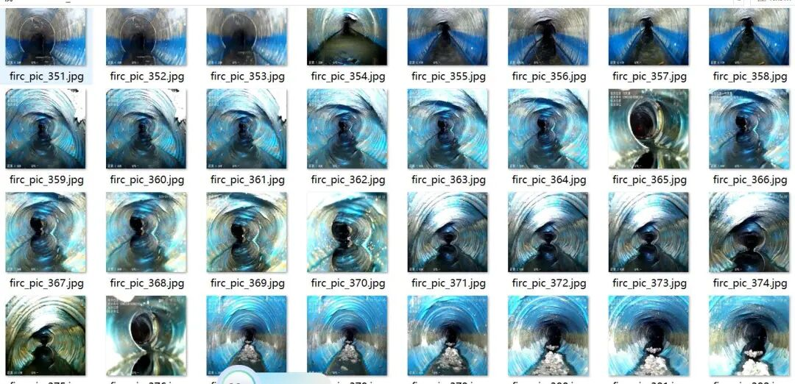
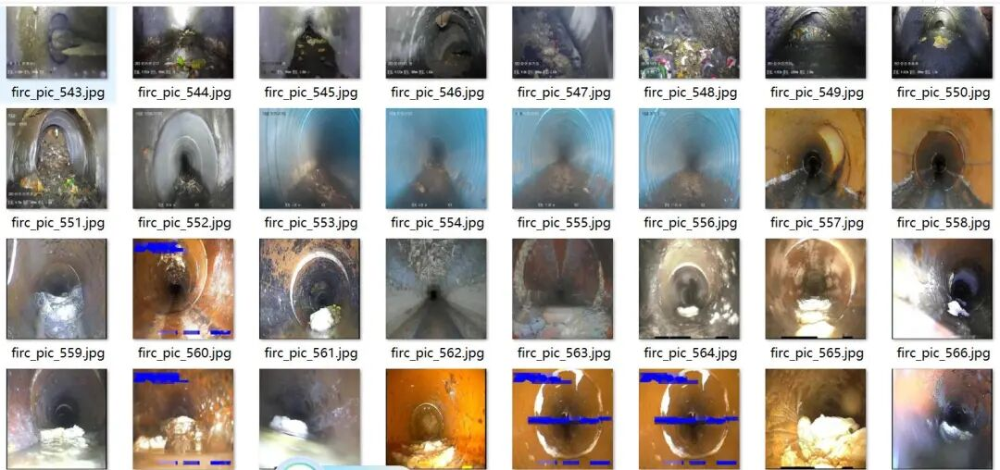
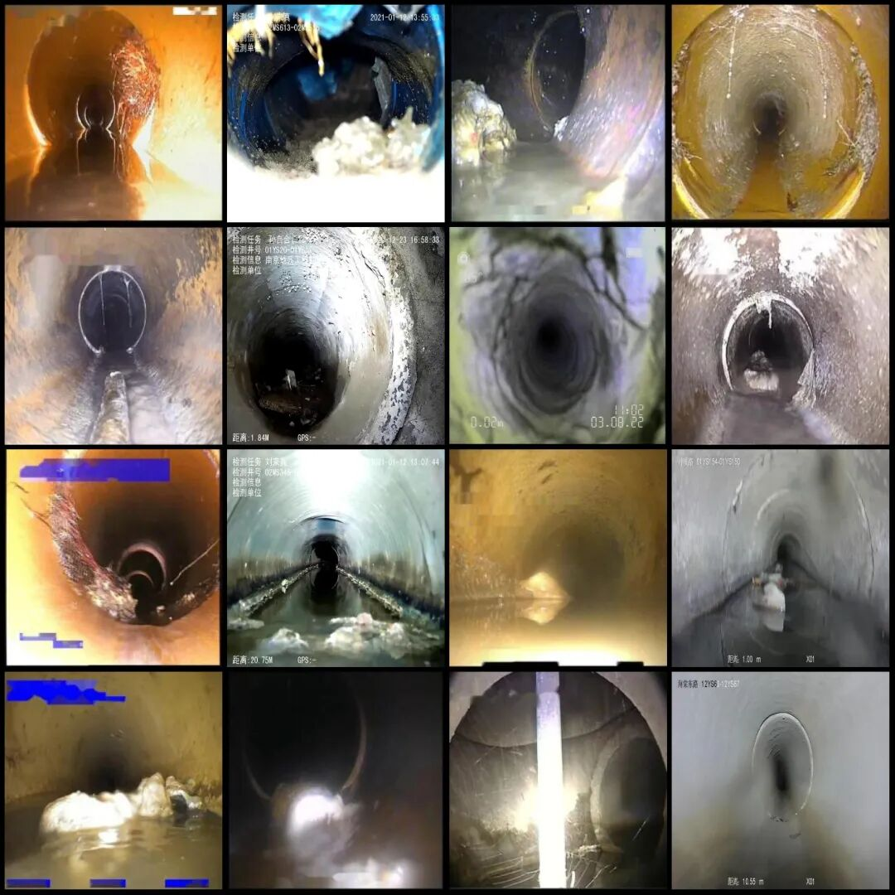
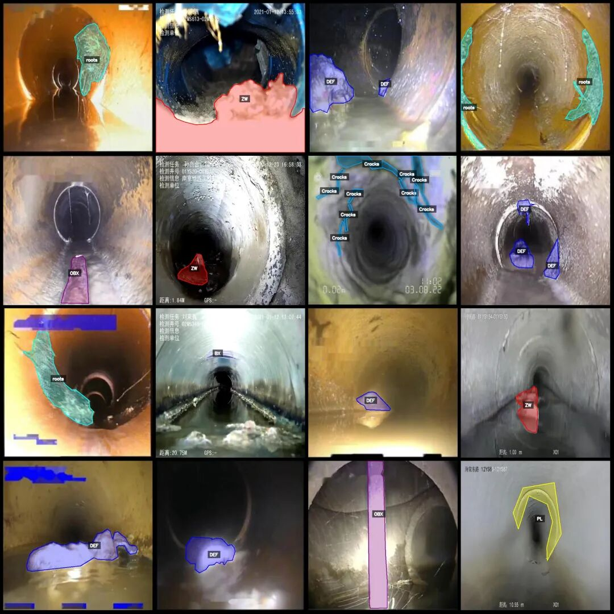
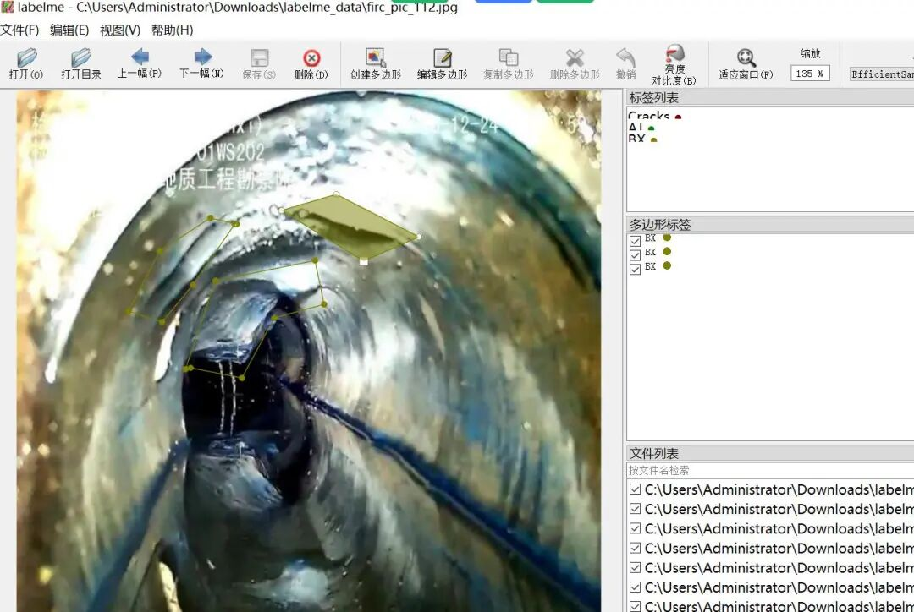

# Drainage Pipe Defect Identification and Segmentation Dataset - labelme format: 3890 images, 12 categories

Dataset format: labelme format (without mask files, only including jpg images and corresponding json files)

Number of images (number of jpg files): 3890

Number of annotations (number of json files): 3890

Label category count: 12

Label category names: ["AJ", "BX", "CJ", "Cracks", "DEF", "DES", "OBB", "OBX", "PL", "QF", "ZW", "roots"]

Number of boxes labeled in each category:

AJ (Dark Water Pipe) count = 98

BX (pipe deformation) count = 549

CJ (deposition) count = 51

Cracks (cracks) count = 112

DEF (deformation) count = 936

DES (strip) count = 1062

OBB (Ruled foreign objects, such as stones, bricks, etc.) count = 115

OBX (Irregular Objects) count = 203

PL (Break) count = 214

QF (Pipeline connection) count = 68

ZW (junk) count = 1191

Roots (Tree Roots) count = 1326

Total frames: 5925

Using labeling tool: labelme=5.5.0

Image resolution: 640x640

Annotation rules: Draw polygons around the categories.

Important Notice: The dataset can be opened and edited using LabelMe. For JSON datasets, one must convert them into mask or Yolo formats for semantic segmentation or instance segmentation.

Special : This dataset does not guarantee the accuracy of the trained models or weight files.

Image Preview:

Annotation example:

Original image (pick 16 randomly):

Annotation:

LabelMe editing example:

## Payment

Here is a pay link on Stripe ( https://buy.stripe.com/3cs8yP7sY87d0vu9AB ). Please contact me lonlonago@foxmail.com after funding $89, and I will send you a complete data files , thank you!

